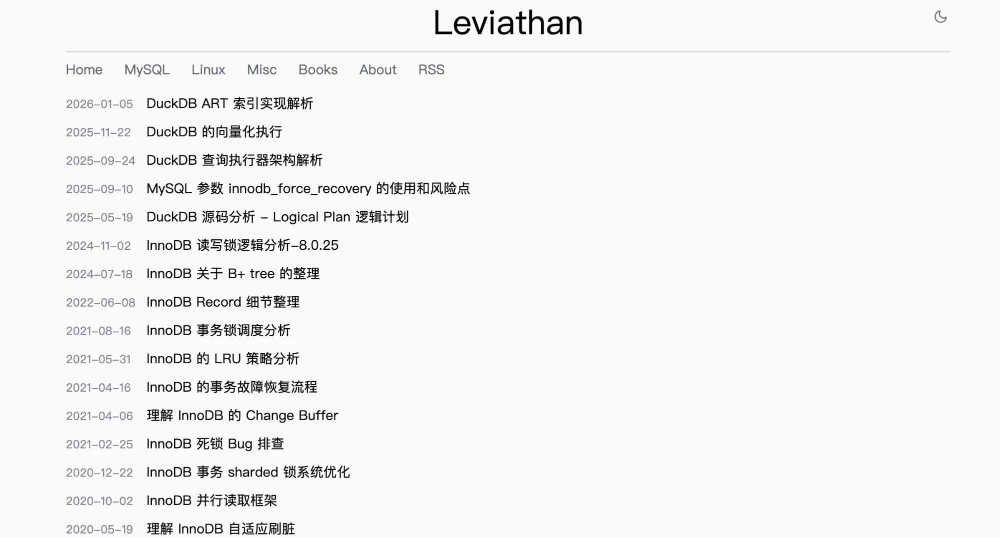

# polk-x

一个简洁、注重排版的 [Hugo](https://gohugo.io/) 博客主题。

在线演示：[leviathan.vip](https://leviathan.vip/)



## 功能

- 首页和标签页按日期倒序归档文章，支持分页
- 文章页自动生成目录
- 明暗主题跟随系统设置，并记住访客的手动选择
- 所有代码块都可以一键复制，支持触屏和键盘操作
- 表格和长代码块在窄屏上可以横向滚动
- 可选的 Atom 订阅、站点图标和副标题
- CSS 和 JS 带内容指纹和子资源完整性校验

## 快速开始

在已有的 Hugo 站点中添加主题：

```bash
git submodule add https://github.com/leviathan0992/hugo-theme-polk-x.git themes/polk-x
```

在 `hugo.yaml` 中启用：

```yaml
baseURL: "https://example.com/"
title: "我的博客"
theme: "polk-x"

markup:
  highlight:
    noClasses: false   # 使用主题自带的代码高亮配色

menu:
  main:
    - { name: "首页", url: "/", weight: 10 }
    - { name: "标签", url: "/tags/", weight: 20 }
```

创建第一篇文章并启动预览：

```bash
hugo new content posts/hello-world.md
hugo server --buildDrafts
```

首页列出 `posts` 目录下的文章。已在 Hugo `0.153.2` 上测试。

## 配置

以下参数都写在 `params` 下，均为可选项。

| 参数 | 默认值 | 说明 |
| --- | --- | --- |
| `subtitle` | — | 显示在站点标题下方，并附加到首页的 `<title>` 中。 |
| `description` | — | 页面的 `description` 元信息。 |
| `keywords` | — | 页面的 `keywords` 元信息。文章设置了 `tags` 时，优先使用文章标签。 |
| `separator` | `-` | 页面标题与站点名称之间的分隔符。 |
| `author` | 站点 `title` | Atom 订阅中的作者名称。 |
| `favicon` | — | 站点图标路径，例如放在 `static/` 下的 `/favicon.png`。 |
| `rss` | — | Atom 订阅路径，见 [Atom 订阅](#atom-订阅)。 |
| `tagTitleWhitelist` | `["summary", "about me"]` | 标签页默认不显示标签名作为标题，名称在此列表中的标签（不区分大小写）除外。 |

`favicon` 和 `rss` 可以写站点内的相对路径，部署到子目录时会自动补上 `baseURL` 中的路径前缀；也可以写外部绝对地址，原样使用。

<details>
<summary>完整配置示例</summary>

```yaml
baseURL: "https://example.com/"
title: "我的博客"
theme: "polk-x"
languageCode: "zh-CN"

pagination:
  pagerSize: 20

permalinks:
  posts: "/:year/:month/:day/:contentbasename/"   # 需要 Hugo >= 0.144，旧版本可用 :slug

taxonomies:
  tag: "tags"

markup:
  highlight:
    noClasses: false
    lineNumbers: false

params:
  subtitle: "记录代码与生活"
  description: "个人博客"
  keywords: "博客, 技术"
  separator: "-"
  favicon: "/favicon.png"
  rss: "/atom.xml"

menu:
  main:
    - { name: "首页", url: "/", weight: 10 }
    - { name: "标签", url: "/tags/", weight: 20 }
    - { name: "关于", url: "/about/", weight: 30 }
```

</details>

## Front Matter

```yaml
---
title: "Hello World"
date: 2026-01-01T10:00:00+08:00
tags: ["hugo", "博客"]
toc: false   # 目录默认开启
---
```

带有 `draft` 标签的文章不会出现在首页，但仍会被构建。

## Atom 订阅

将以下配置合并到 `hugo.yaml`，并设置 `params.rss: "/atom.xml"`：

```yaml
outputs:
  home: ["HTML", "ATOM"]

mediaTypes:
  "application/atom+xml":
    suffixes: ["xml"]

outputFormats:
  ATOM:
    mediaType: "application/atom+xml"
    baseName: "atom"
    isPlainText: true
    rel: "alternate"
```

订阅文件生成在 `public/atom.xml`，每个页面的 `<head>` 中都会带上订阅链接。

## 自定义

在站点根目录放一个与主题同路径的文件，就可以覆盖主题的对应文件。例如，站点中的 `assets/css/style.css` 会完整替换主题的样式表，Hugo 不会合并两份文件。

| 路径 | 用途 |
| --- | --- |
| `assets/css/style.css` | 页面布局、明暗主题、代码高亮 |
| `assets/js/main.js` | 主题切换、代码复制、图片懒加载 |
| `layouts/_default/baseof.html` | 页面骨架 |
| `layouts/index.html` | 首页归档 |
| `layouts/_default/list.html` | 标签文章列表 |
| `layouts/_default/terms.html` | 标签索引 |
| `layouts/posts/single.html` | 文章页 |
| `layouts/_default/single.html` | 独立页面 |
| `layouts/partials/` | 页头、页眉、页脚、分页、文章目录 |

主题没有内置评论系统。需要评论时，覆盖 `layouts/posts/single.html` 即可。

## 来源和许可

基于 [hexo-theme-polk](https://github.com/chunqiuyiyu/hexo-theme-polk)，使用 [MIT 许可证](LICENSE)。
